# Air Traffic

Air Traffic ist ein „Browser-Verteiler“ für macOS. Die App wird als Standardbrowser eingetragen,
nimmt jeden angeklickten Link entgegen, prüft ihn gegen deine Regeln, schreibt ihn bei Bedarf um
und öffnet ihn im passenden Browser oder in der passenden App. Passt keine Regel, entscheidet die
Standardaktion – zum Beispiel ein kleines Auswahlfenster mit allen Browsern.

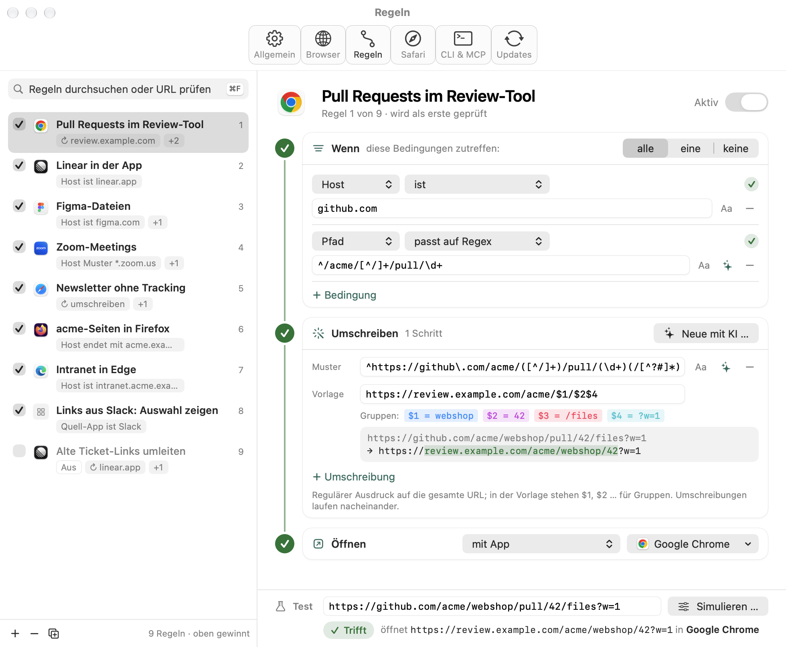

## Trailer

[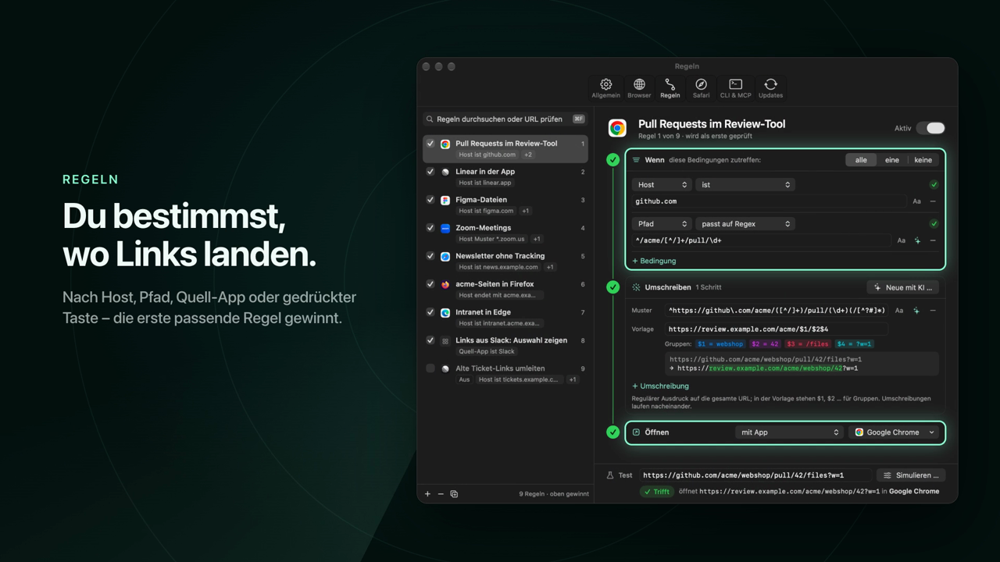](Design/Trailer/air-traffic-trailer.mp4)

15 Sekunden, ohne Ton: Regeln, Umschreiben, Auswahlfenster, KI-Assistent und Kommandozeile –
[MP4 ansehen](Design/Trailer/air-traffic-trailer.mp4).

## Funktionen

- **Regeln:** Bedingungen auf URL, Host, Pfad, Quell-App, gedrückte Tasten und Linktyp
  (ist, enthält, beginnt mit, endet mit, Muster, regulärer Ausdruck …). Die erste passende Regel gewinnt.
- **Umschreiben:** Regex-Umschreibungen vor dem Öffnen, etwa GitHub-Pull-Requests in ein Review-Tool
  umleiten oder Tracking-Parameter entfernen. Mehrere Schritte laufen nacheinander.
- **Test je Regel:** Test-URL im Regel-Editor zeigt live, welche Bedingung trifft, jeden
  Umschreibschritt, die Ergebnis-URL und ob eine frühere Regel zuerst greift.
- **URL prüfen:** eine URL ins Suchfeld der Regel-Liste einfügen und sehen, welche Regel greift,
  welche zusätzlich träfe, aber verdeckt ist, und – unter „Alle Regeln“ – woran die übrigen scheitern.
  Quell-App und gedrückte Tasten lassen sich simulieren.
- **Auswahlfenster:** Browser per Zifferntaste wählen, URL vor dem Öffnen bearbeiten, `⌥⏎` öffnet im Hintergrund.
- **KI-Assistent:** beschreibe eine Umschreibung oder Bedingung in Worten, die App erzeugt den
  regulären Ausdruck und prüft ihn lokal an deinen Beispiel-URLs. Drei Anbieter:
  - OpenRouter (eigener API-Key),
  - Claude-Abo über die installierte Claude-Code-CLI,
  - ChatGPT-Abo über die installierte Codex-CLI.
- **Safari-Erweiterung:** schickt Links aus Safari per Rechtsklick oder Symbolleisten-Knopf an Air Traffic,
  auf Wunsch mit eigenem Verhalten (Regeln aus, eigene Aktion).
- **Kommandozeile & KI-Agenten:** `airtraffic` liest, prüft und ändert Regeln im Terminal und
  läuft als MCP-Server für Claude Code, Codex & Co. – mit Sicherung vor jeder Änderung.
- **Choosy-Import:** übernimmt Regeln und Browserliste aus Choosy.
- **Updates:** prüft täglich auf neue Versionen (Sparkle) und installiert sie automatisch –
  sobald weder Auswahlfenster noch Einstellungen offen sind.
- **Hell und dunkel:** folgt standardmäßig macOS; unter Allgemein → Darstellung fest auf Hell oder Dunkel stellbar.

Die Einstellungen haben sechs Tabs: **Allgemein** (Standardbrowser, Standardaktion, KI-Assistent,
Darstellung, Choosy-Import und Konfigurationsdatei), **Browser**, **Regeln**, **Safari**, **CLI & MCP** und **Updates**.

| Auswahlfenster | Allgemein |
|---|---|
| 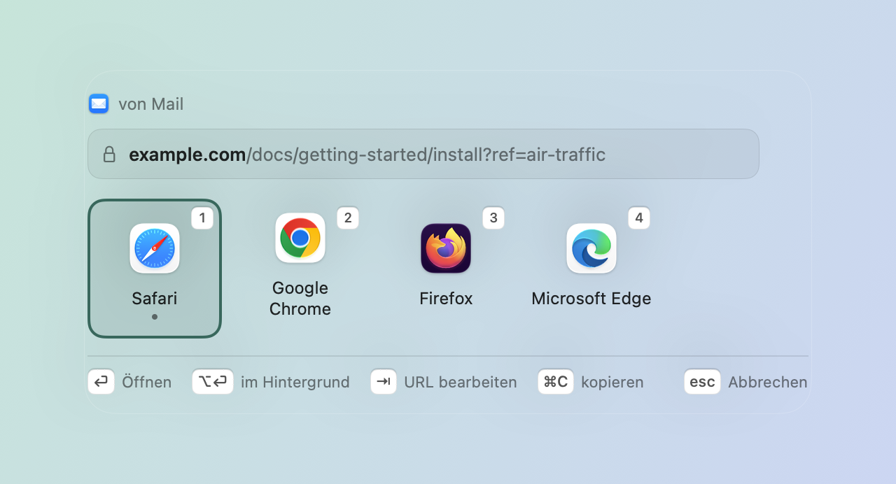 | 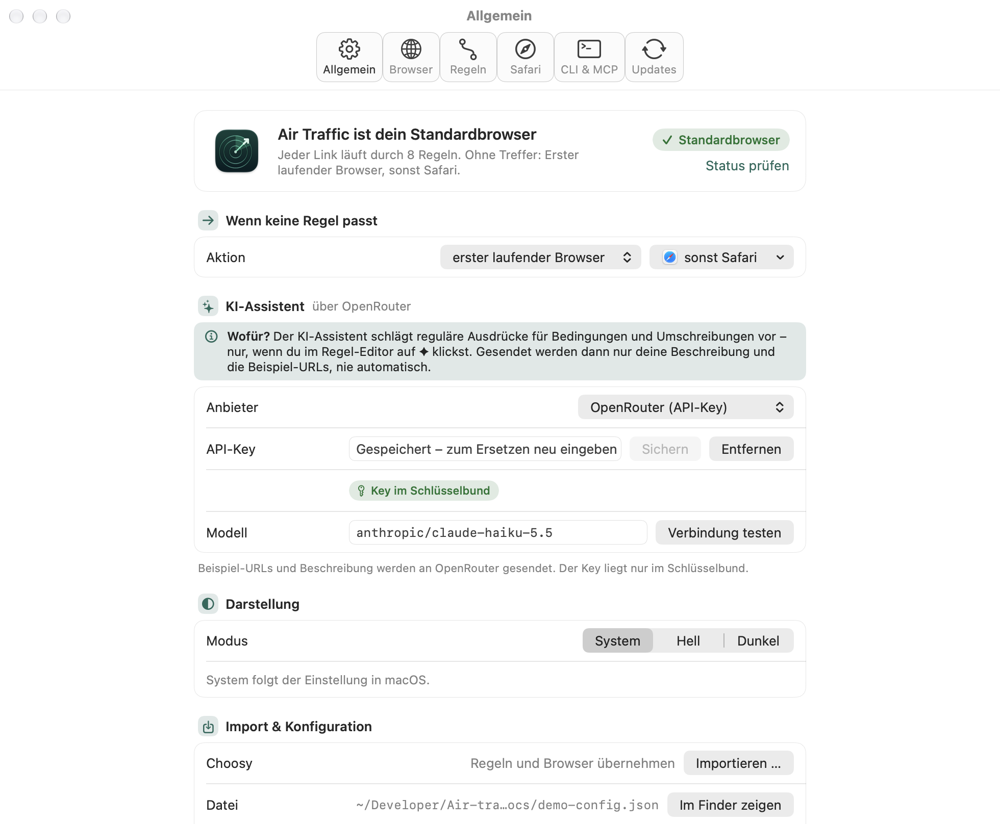 |

| URL prüfen | Alle Regeln (dunkel) |
|---|---|
| 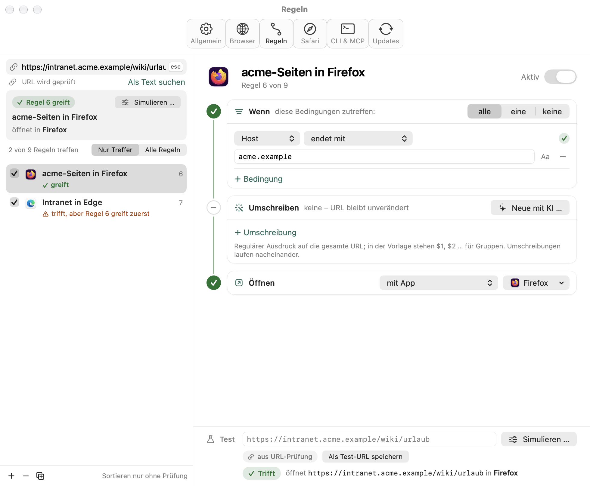 | 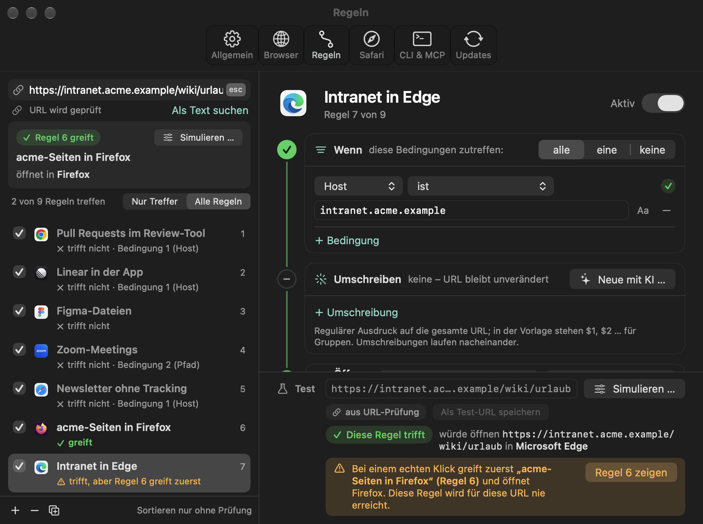 |

| Browser | KI-Assistent |
|---|---|
| 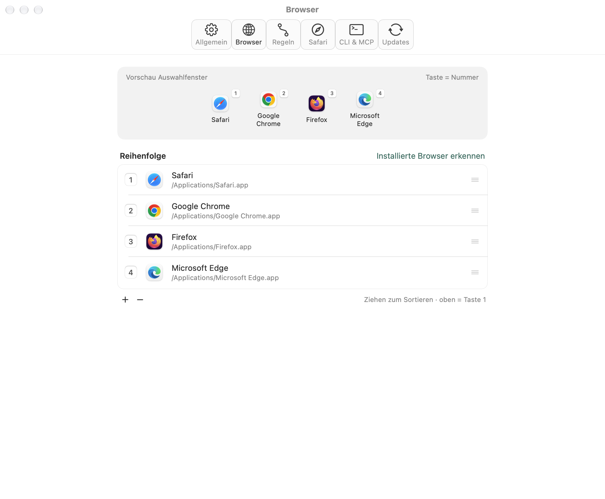 | 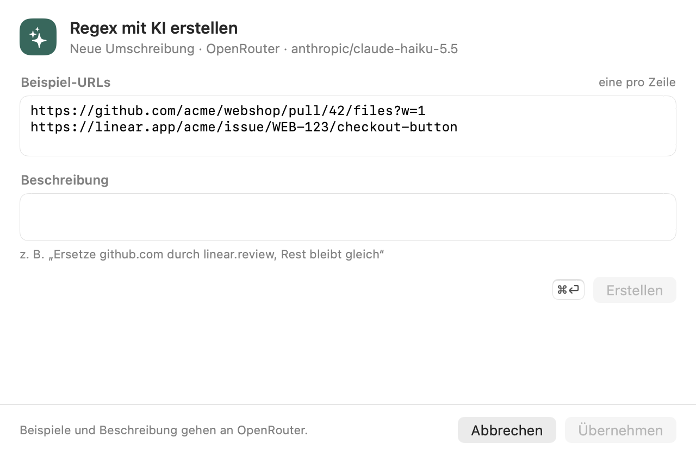 |

| Safari | CLI & MCP |
|---|---|
| 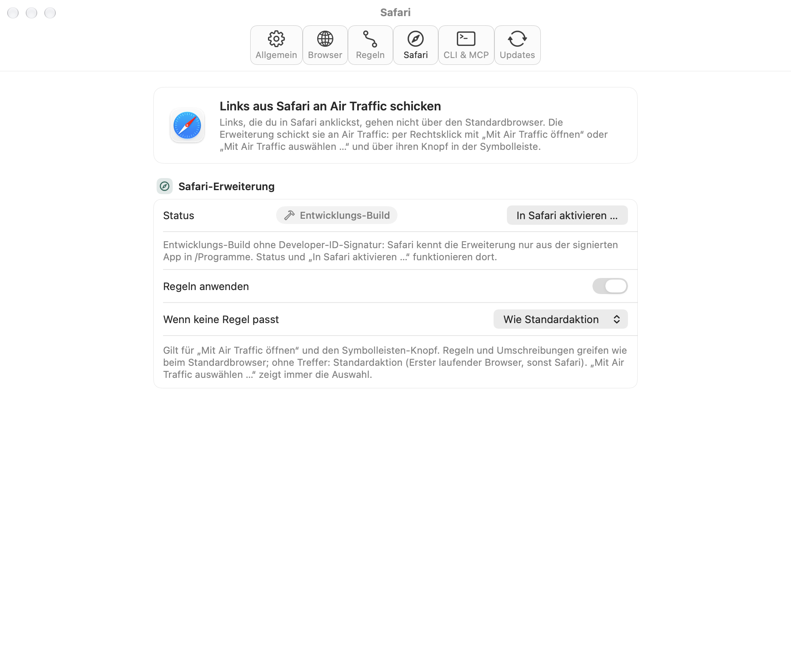 | 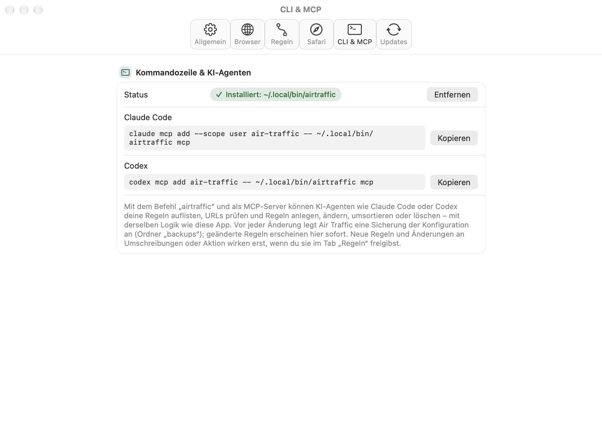 |

Alle Screenshots stammen aus der neutralen Beispiel-Konfiguration [`docs/demo-config.json`](docs/demo-config.json).

## Installation

1. Das neueste `Air-Traffic-<version>.zip` unter
   [Releases](https://github.com/neoskop/air-traffic/releases) laden und entpacken.
2. `Air Traffic.app` nach `/Programme` ziehen.
3. Starten. Die App ist mit Developer ID signiert und von Apple notarisiert; Gatekeeper lässt sie
   ohne Umweg zu.
4. In den Einstellungen unter **Allgemein** auf „Als Standardbrowser festlegen“ klicken und bestätigen.

Voraussetzung: macOS 15 oder neuer.

## Safari-Erweiterung

Links, die du in Safari anklickst, öffnet Safari selbst – sie gehen nicht über den Standardbrowser,
deine Regeln greifen also nicht. Die mitgelieferte Erweiterung schickt solche Links gezielt an Air Traffic.

**Aktivieren:** Air Traffic → Einstellungen → Tab **Safari** → „In Safari aktivieren …“, dort
„Air Traffic“ einschalten. Alternativ direkt in Safari → Einstellungen → Erweiterungen. Der Tab in
Air Traffic zeigt, ob die Erweiterung aktiv ist.

**Bedienung:**

- Rechtsklick auf einen Link → **Mit Air Traffic öffnen**: läuft durch deine Regeln wie jeder andere Link.
  Als Quell-App gilt Safari (`com.apple.Safari`). Im Tab **Safari** lassen sich die Regeln für diese Links
  abschalten und eine eigene Aktion wählen (z. B. immer das Auswahlfenster).
- Rechtsklick auf einen Link → **Mit Air Traffic auswählen …**: Umschreibungen der passenden Regel
  werden angewendet, dann erscheint immer das Auswahlfenster mit allen Browsern.
- **Symbolleisten-Knopf** (Air-Traffic-Symbol): öffnet die aktuelle Seite mit Air Traffic.

Die Erweiterung braucht keinen Zugriff auf Webseiten: Sie liest nur den angeklickten Link bzw. die
URL des aktiven Tabs und übergibt sie über das URL-Schema
`airtraffic://open?url=<prozentkodiert>[&source=<bundleID>][&prompt=1]` an die App.

## Kommandozeile & KI-Agenten

Die App bringt das Programm `airtraffic` mit (`Air Traffic.app/Contents/Helpers/airtraffic`). Damit
lassen sich Regeln im Terminal auflisten, prüfen, anlegen, ändern, umsortieren und löschen – mit
derselben Logik wie die App. `airtraffic mcp` macht dasselbe als MCP-Server für KI-Agenten.

**Installieren:** Einstellungen → Tab **CLI & MCP** → „Installieren“. Das legt den Symlink `~/.local/bin/airtraffic` an (kein Administrator nötig);
„Entfernen“ löscht nur diesen Symlink. Fehlt `~/.local/bin` im `PATH`, zeigt die App die Zeile für
`~/.zshrc`: `export PATH="$HOME/.local/bin:$PATH"`.

**Beispiele:**

```sh
airtraffic rules list                                   # alle Regeln, oben gewinnt
airtraffic check "https://github.com/acme/webshop/pull/42" --source com.tinyspeck.slackmacgap
airtraffic rules add --name "Figma in der App" --host www.figma.com --open Figma \
  --test-url "https://www.figma.com/file/abc"
airtraffic rules add --at 1 < regel.json                # Regel als JSON (Format: airtraffic schema)
echo '{"enabled": false}' | airtraffic rules update "#3" --dry-run
airtraffic rules move "Figma in der App" --to 2
airtraffic rules delete 3f2a9c1e                        # UUID-Präfix ab 6 Zeichen
```

- `<ref>` ist eine UUID, ein eindeutiges UUID-Präfix (ab 6 Zeichen), eine Position (`#3`) oder der exakte Name.
- Regeln ein und aus im selben JSON wie `config.json`; Ziel-Apps auch kurz als Name, Bundle-ID oder Pfad
  (`"action": {"type": "open", "app": "Google Chrome"}`). `airtraffic schema` beschreibt das Format mit Beispielen.
- `--json` gibt alles maschinenlesbar aus, `--dry-run` zeigt eine Änderung, ohne zu schreiben.
  Jede Änderung antwortet mit der Regel und einer Prüfung ihrer Test-URL (bei wartenden Regeln auch „nach Freigabe“).
- **Neue Regeln und Änderungen an Umschreibungen oder Aktion warten auf deine Freigabe in der App** und wirken
  bis dahin nicht (siehe [Sicherheit](#sicherheit)). Name, Bedingungen, Test-URL, Position und an/aus wirken sofort.
- Vor jedem Schreiben legt `airtraffic` eine Sicherung unter `~/Library/Application Support/Air Traffic/backups/`
  an (alle der letzten 24 Stunden, höchstens 100, dazu je Tag die neueste und die älteste für 14 Tage).
  Ändern läuft koordiniert und atomar; die laufende App lädt die Regeln sofort neu.
- Browserliste, Standardaktion und KI-Einstellungen lassen sich nur lesen (`airtraffic browsers list`,
  `airtraffic settings`), nicht ändern.

**Als MCP-Server einbinden** (stdio, JSON-RPC 2.0):

```sh
claude mcp add --scope user air-traffic -- ~/.local/bin/airtraffic mcp
codex mcp add air-traffic -- ~/.local/bin/airtraffic mcp
```

Tools: `describe_rule_format`, `list_rules`, `get_rule`, `create_rule`, `update_rule`, `move_rule`,
`set_rule_enabled`, `delete_rule`, `check_url`, `list_browsers`, `get_settings`. Der Server arbeitet nur
lokal mit der Konfigurationsdatei: kein Netzwerk, kein Schlüsselbund, er öffnet keine Links.

## Bauen aus dem Quellcode

Benötigt Xcode 27 und [XcodeGen](https://github.com/yonaskolb/XcodeGen) (`brew install xcodegen`).

```sh
xcodegen generate
xcodebuild -project AirTraffic.xcodeproj -scheme AirTraffic -configuration Debug \
  -derivedDataPath build build
open "build/Build/Products/Debug/Air Traffic.app"
```

Das Xcode-Projekt wird aus `project.yml` erzeugt und nicht eingecheckt. Sparkle kommt als
Swift-Package (Version 2.10.1) und wird beim ersten Build geladen.

Aufbau:

- `App/` – AppKit-App mit SwiftUI-Ansichten (Auswahlfenster, Einstellungen, Updates).
- `SafariExtension/` – Safari-Web-Extension (Manifest V3, `background.js`) und
  `SafariWebExtensionHandler`; wird als `Contents/PlugIns/SafariExtension.appex` eingebettet.
- `CLI/` – dünne Hülle des Kommandozeilen-Tools `airtraffic` (Target `AirTrafficCLI`); die Befehle,
  die Validierung und der MCP-Server liegen im Core. Wird als `Contents/Helpers/airtraffic` eingebettet.
- `Packages/AirTrafficCore/` – Regeln, Umschreiben, Konfiguration, Choosy-Import, KI-Assistent,
  Agenten-Schnittstelle (Kommandozeile, MCP);
  nur Foundation und CryptoKit (kein AppKit), vollständig getestet.
- `Design/Trailer/` – 15-Sekunden-Trailer: `trailer.html` (Animation aus den Screenshots in `docs/images`,
  im Browser abspielbar, `?t=<Sekunde>` springt zu einem Zeitpunkt) und `render.mjs`, das sie Bild für Bild
  zu `air-traffic-trailer.mp4` rendert (braucht `playwright-core` mit Chromium und `ffmpeg`):
  `PLAYWRIGHT_CORE=<pfad>/node_modules/playwright-core node Design/Trailer/render.mjs`.

**Safari-Erweiterung beim Entwickeln:** Debug-Builds sind nur ad hoc signiert. Safari lädt die
Erweiterung dann erst nach Safari → Einstellungen → Erweitert → „Funktionen für Webentwickler einblenden“
und Entwickler → „Nicht signierte Erweiterungen erlauben“ (gilt bis zum Beenden von Safari).
Ist zusätzlich eine installierte Air Traffic in `/Programme` vorhanden, entscheidet macOS, welche Kopie
`airtraffic://` öffnet – zum Testen nur eine Kopie registriert lassen. Safari führt die Erweiterung unter
ihrer Team-ID; im Debug-Build zeigt der Tab **Safari** deshalb „Entwicklungs-Build“ statt des Status.
Startet man den Debug-Build, meldet macOS dessen Erweiterung an. Nach dem Testen wieder auf die installierte
App umstellen:

```sh
LSREG=/System/Library/Frameworks/CoreServices.framework/Frameworks/LaunchServices.framework/Support/lsregister
"$LSREG" -u "build/Build/Products/Debug/Air Traffic.app"
"$LSREG" -f "/Applications/Air Traffic.app"
```

Wurde `airtraffic` aus dem Debug-Build installiert, zeigt der Tab **CLI & MCP** danach „Zeigt auf eine
andere App-Kopie“ – einmal „Aktualisieren“ klicken.

## Tests

```sh
swift test --package-path Packages/AirTrafficCore
```

Die Tests laufen ohne Netzwerk und ohne echte KI-Aufrufe (Fake-Clients und Fake-Prozesse).

## Debug-Schalter

Nur im **Debug-Build** – der Release-Build kennt sie nicht und startet mit ihnen ganz normal. Alle Schalter
starten ohne Fenster und beenden sich danach. `AIRTRAFFIC_CONFIG_PATH=<datei>` lenkt auf eine andere
Konfiguration um.

```sh
APP="build/Build/Products/Debug/Air Traffic.app/Contents/MacOS/Air Traffic"

# Entscheidung für eine URL als JSON (welche Regel, Ergebnis-URL, Aktion)
"$APP" --decide "https://github.com/acme/webshop/pull/42" [--source com.tinyspeck.slackmacgap]
# … auch für airtraffic://-Links, wie sie die Safari-Erweiterung schickt (öffnet nichts)
"$APP" --decide "airtraffic://open?url=https%3A%2F%2Fgithub.com%2Facme%2Fwebshop%2Fpull%2F42&source=com.apple.Safari&prompt=1"

# KI-Vorschlag als JSON (Anbieter sonst aus der Konfiguration)
"$APP" --suggest-regex "Ersetze github.com durch review.example.com" \
  --example "https://github.com/acme/webshop/pull/42" [--mode rewrite|condition] \
  [--provider openrouter|claude|codex]

# PNGs aller Ansichten in hell und dunkel
"$APP" --snapshot /tmp/air-traffic-snapshots
```

Die README-Screenshots erzeugt `scripts/screenshots.sh` (baut die App und rendert mit
`docs/demo-config.json` nach `docs/images/`).

## Release

```sh
scripts/release.sh 1.1 --notes "- Neu: …"      # oder Abschnitt „## 1.1“ in CHANGELOG.md
scripts/release.sh 1.1 --dry-run               # nur bauen und signieren
scripts/release.sh 1.1 --dry-run --no-sign     # nur bauen
```

Das Skript setzt `MARKETING_VERSION` und `CURRENT_PROJECT_VERSION` (Build + 1) in `project.yml`, baut
die Release-Version, signiert sie mit Developer ID (Safari-Erweiterung zuerst, mit ihren Sandbox-Entitlements,
dann das Kommandozeilen-Tool, beide mit Hardened Runtime)
und lässt sie notarisieren, packt `build/dist/Air-Traffic-<version>.zip`, signiert es mit Sparkles
`sign_update` (EdDSA-Schlüssel im Schlüsselbund, Account `air-traffic`; die Werkzeuge lädt es bei Bedarf
nach `build/sparkle-tools`), ergänzt `appcast.xml` und legt das GitHub-Release `v<version>` mit dem ZIP
an. Commit und Push macht es nicht – es druckt die Befehle dafür. Erst mit dem Push von `appcast.xml`
sehen installierte Apps das Update. `project.yml` und `appcast.xml` erst committen, wenn das Skript ohne
Fehler durchgelaufen ist.

## Sicherheit

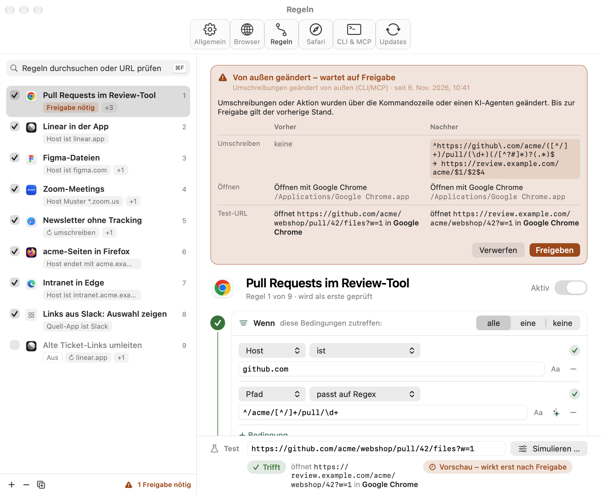

- **Freigabe für Änderungen von außen:** Legt `airtraffic` oder ein KI-Agent über MCP eine Regel an oder ändert
  Umschreibungen oder Aktion einer Regel, wird das nicht sofort wirksam. Die Regel bekommt in der Liste den
  orangen Chip „Freigabe nötig“, die Fußleiste zählt wartende Regeln, und der Editor zeigt Vorher/Nachher mit
  einer Vorschau für die Test-URL. Erst **Freigeben** macht die Änderung wirksam; **Verwerfen** stellt den vorherigen
  Stand wieder her bzw. löscht eine neu angelegte Regel. Bis dahin gilt der zuletzt freigegebene Stand – auch für
  `check` und die URL-Prüfung. Agenten können nicht freigeben (kein Befehl, kein Tool). Nach jeder Änderung von
  außen erscheint eine Mitteilung „Regeln von außen geändert“; ohne Mitteilungs-Berechtigung bleibt die orange
  Zeile im Einstellungsfenster.
- **Ziel sichtbar:** Kurzbeschreibungen zeigen bei Umschreibungen das Ziel (z. B. „↻ review.example.com“).
- **Schema-Regel:** Nach dem Umschreiben ist nur `http`/`https` erlaubt, das Schema der Original-URL oder ein
  Schema, das literal am Anfang der Vorlage steht (`linear://…`). Ein Schema aus der URL selbst (`?u=file:///…`
  über `$1`) wird verworfen – dann gilt die Original-URL mit Warnung. `file:` öffnet Air Traffic nur, wenn der
  Link schon `file:` war.
- **Grenzen gegen Hänger:** Links über 8192 Zeichen prüft Air Traffic nicht gegen Regeln (Auswahlfenster mit
  Hinweis). Platzhalter-Muster laufen ohne reguläre Ausdrücke in linearer Zeit; reguläre Ausdrücke haben je Link
  zusammen höchstens 500 ms – danach gilt die Regel als „trifft nicht“.
- **Auswahlfenster:** höchstens 5 wartende Links (gleiche zusammengefasst), Ziffern und ⏎ wirken erst 300 ms nach
  dem Erscheinen, `airtraffic://…&prompt=1` höchstens 3-mal in 10 s, lange Hosts werden vorne gekürzt
  (`…evil.example`). Kreist ein Link (dieselbe URL mehr als 3-mal in 5 s), fragt Air Traffic nach.
- **`airtraffic://`:** `source` wird nur als `com.apple.Safari` übernommen. Kommt der Link nicht von der eigenen
  Safari-Erweiterung, steht im Auswahlfenster „über airtraffic://-Link“ statt „von Safari“.
- **KI-CLI:** Ein eigener Pfad für Claude Code bzw. Codex gilt nur, wenn die Datei `claude` bzw. `codex` heißt.

## Datenschutz

- Air Traffic sendet Links nirgendwohin: Regeln, Umschreibungen und Tests laufen lokal.
- Die Safari-Erweiterung hat keine Website-Berechtigungen und kein Content-Script; sie sieht nur den
  Link, den du per Rechtsklick oder Symbolleisten-Knopf an Air Traffic schickst.
- Der KI-Assistent arbeitet **nur auf Klick** (✦ im Regel-Editor). Gesendet werden dann nur deine
  Beschreibung und die Beispiel-URLs – an OpenRouter bzw. über die lokale CLI an Anthropic oder OpenAI.
- Der OpenRouter-API-Key liegt nur im macOS-Schlüsselbund, nie in der Konfigurationsdatei oder im Log.
  Claude Code und Codex nutzen ihre eigene Anmeldung; Air Traffic sieht keine Zugangsdaten.
- Die Update-Prüfung lädt nur `appcast.xml` von GitHub; Updates werden über ihre EdDSA-Signatur geprüft.
- `airtraffic` und der MCP-Server arbeiten nur lokal mit der Konfigurationsdatei: kein Netzwerk, kein
  Schlüsselbund, sie öffnen keine Links und ändern nicht den Standardbrowser. Was ein KI-Agent über den
  MCP-Server liest (deine Regeln), sieht natürlich auch dessen Anbieter.
- Das Systemprotokoll enthält keine URLs im Klartext: Links, Warnungen der Regeln und Fehlermeldungen mit
  URL-Teilen sind als privat markiert. Lesbar bleiben nur Bundle-IDs, App-Pfade, Zähler und Regelnamen.
- Codex läuft für den KI-Assistenten in einer nur lesenden Sandbox; es darf dabei Dateien lesen. Die Anfrage
  weist es an, keine Werkzeuge oder Shell zu nutzen und nur JSON zu antworten.

Konfiguration: `~/Library/Application Support/Air Traffic/config.json`, Sicherungen vor Änderungen über
`airtraffic` im Ordner `backups/` daneben (alle der letzten 24 Stunden, je Tag die neueste und älteste für 14 Tage).

## Lizenz

MIT – siehe [LICENSE](LICENSE). © 2026 Neoskop GmbH.
